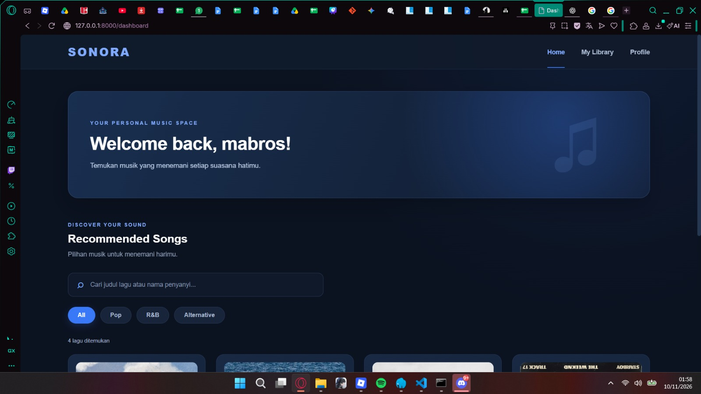
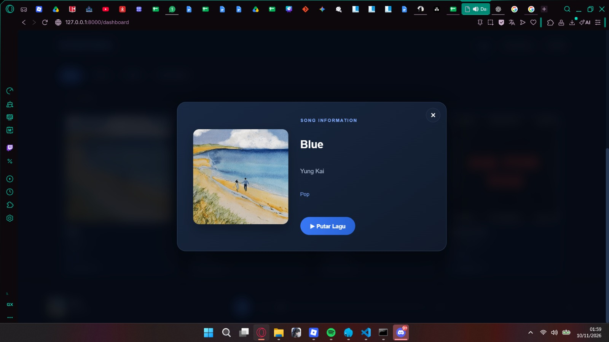
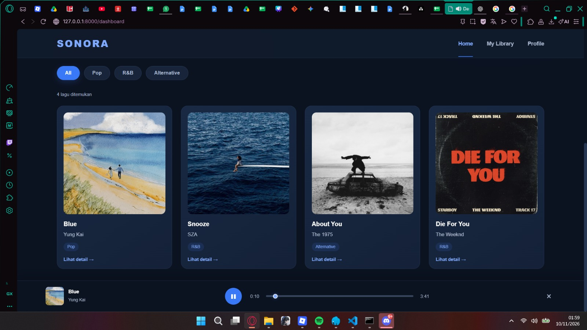
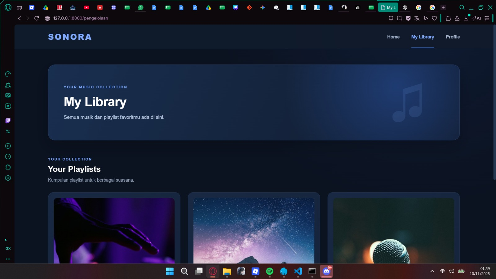
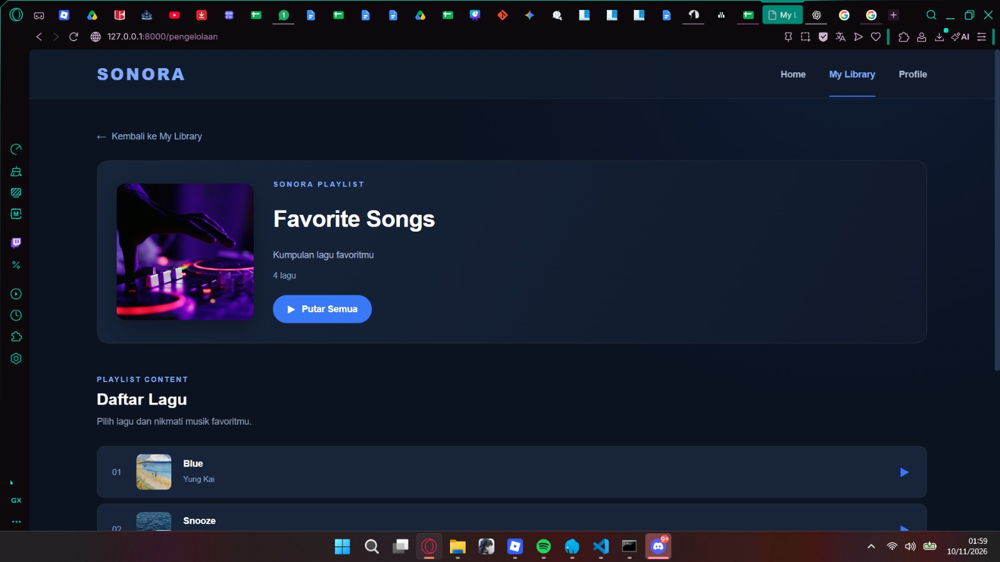
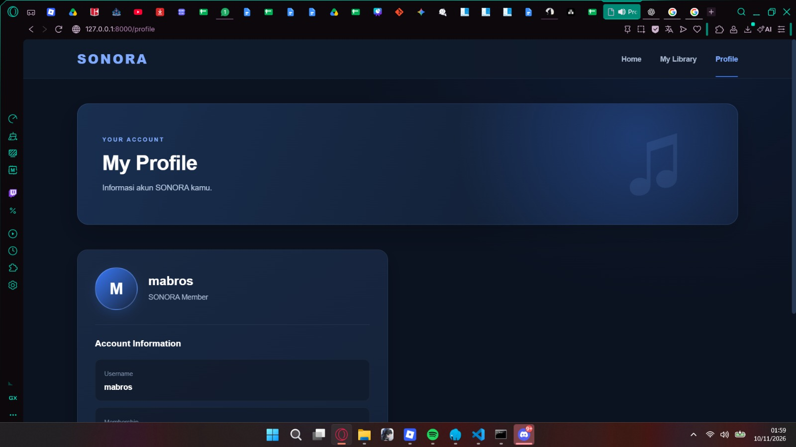

# SONORA — Music Discovery & Listening Platform

## About SONORA

SONORA is a music platform designed to provide a simple and enjoyable experience for discovering and listening to music. With a modern dark navy and blue interface, SONORA allows users to explore various songs, discover music by genre, and enjoy their favorite tracks through an integrated music player.

## Website Preview

### 1. Dashboard

The Dashboard is the main page where users can explore available music collections, search for songs, filter music by genre, view song details, and play their favorite tracks.

### 2. My Library

My Library provides a collection of playlists where users can explore available music, view playlist details, and play songs individually or sequentially.

### 3. Profile

The Profile page displays the username of the currently accessing user.

## Technologies Used

- Laravel 13
- PHP
- HTML
- CSS
- JavaScript
- Blade Template Engine
